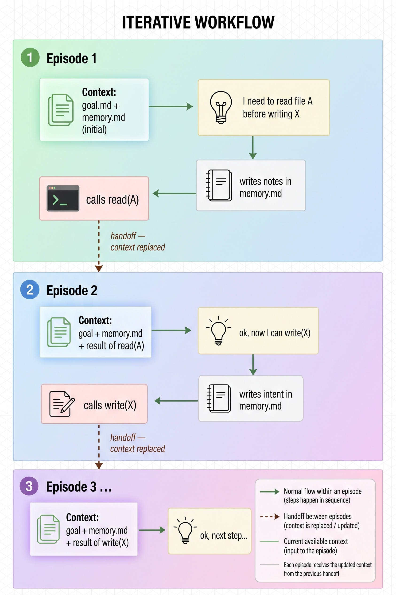

# memento — Master-Document Agent Loop

This is an attempt to solve the problem of shrinking context windows and long term tasks.  
Basically, this forces the agent to first write notes, and then replaces the context after every tool call.  
Instead of the agent seeing all previous information, the agent is presented with: 

* the goal as defined in goal.md 
* A protocol statement explaining the rules 
* It's own ___memory.md___ file
* the result of the last tool call (or calls, adjustable).  

The rules are simple.  The agent has a thinking directory, and a memory.md file.  The agent is free to read, and edit as required inside this thinking directory.  

Before any external reaching tool call the agent must modify memory.md .  
After K (default 1) tool calls the context is replaced, and the agent must operate from its notes.  
In other words, __the agent must write its own context.__  

This does carry a penalty because the agent has to document itself as it works.  The benefit is that the agent continues work with roughly the same context consumed at the beginning of each turn.  (for example, a simple fastapi app took 54s with this extension and 47s without it.)  

**What is it for?**  The intended use case is long, continuous jobs.  For example, I asked this to run the entire human-eval test suite in one session, and it successfully did.  All 164 problems were solved in one go without an external loop.  

## Model choice 

This approach seems to be very sensitive to the specific model used.  It is a reasoning challenge to understand that you are operating in a loop, and smaller models can get lost trying to grasp the circular logic.  Some models with poor instruction following tend to try and make tool calls before saving their intent in memory.md like they've been told.  Nemotron 3.5 lightning 'hits the gate' on 60% of all tool calls.  

Qwen3.8:27b seems to work very well with this loop.  It tends to write itself a note, and get on with and almost never forgets the process.  

I tried Gemini 3.8 flash, which is a very strong reasoning model, but even that tends to forget to write intent and gets stuck in a loop trying to do the same thing multiple times.  _I think it is trained to simply rely on its massive 1M token context, and the idea of note taking is not part of its process._ 

In any case, this is a challenging situation to put a model, and one that they are not inherently trained for.  There are plenty of models yet to try, but so far qwen3.8:27b has been the most successful candidate.  

## The loop

Net effect: context stays roughly the same size at every handoff; continuity lives in `memory.md`, not the conversation.

In pi, this looks like a compaction after every tool call, but the compaction doesn't take time, it is simply rebuilding the context from goal.md and memory.md .

[Initial testing results](./testing.md) from a couple of basic tests.  

## next steps

A model fine-tuned to work with the constraints imposed here could be very interesting.  If it could learn to carry through the reasoning and logic of its ungated "normal" counterpart, you would have a model with equivalent reasoning but very differently shaped context window limitations.  

This implementation as a pi extension causes significant token burn, as the KV cache is rebuilt on every request.  If this was implemented in a modified engine, this could be avoided and the token use would be comparable to normal operation.  

## Files

- `.pi/extensions/memento/index.ts` — the whole implementation (~170 lines), loaded by project discovery
- `goal.md` — your task objective at the project root, gitignored. `.pi/goal.md` also works (legacy location); if both exist, the root one wins. Injected into every request; writes to it are blocked by tools
- `thinking/memory.md` — the agent's belief state (gitignored). Fixed sections: Plan / Facts & Decisions / Pointers / Open Questions / Next Steps. Both `thinking/` and this file are created automatically when the loop arms. 

## Run a task

1. Write the objective into `goal.md` at the project root (or legacy `.pi/goal.md`) — this is part of every request.  
2. Use the slash command '/memento on' then prompt something like: "Begin working toward the stated GOAL." _(the first prompt doesn't really matter, the agent will forget it until it figures out that it is in a loop.)_
3. Watch for `[compaction]` markers in the TUI after external steps — each is a handoff. 

## Config (env)

| Var            | Default                                  | Meaning                                                                                        |
| -------------- | ---------------------------------------- | ---------------------------------------------------------------------------------------------- |
| `MEMENTO_DIR`  | `thinking`                               | thinking dir, relative to project root                                                         |
| `MEMENTO_K`    | `1`                                      | transitions kept verbatim per handoff (an assistant message carrying tool calls + its results) |
| `MEMENTO_GOAL` | `<root>/goal.md`, fallback `.pi/goal.md` | goal file path (env override wins over both)                                                   |

## Invariants enforced by the extension

- Goal file: writes/edits blocked (`tool_call` block with reason).
- Crossing detection is default-crossing: anything not provably inside `thinking/` counts (external paths, path-less greps/finds, all bash, web tools). Purely internal turns never hand off.
- memory.md must change before any external tool call.  

## Using it in another project

Copy `.pi/extensions/memento/` into that project's `.pi/extensions/` (the project must be trusted — see `~/.pi/agent/trust.json`) and give it a `goal.md` at the root (or legacy `.pi/goal.md`). Everything else is resolved relative to the project root, so each project gets its own goal + thinking dir.

Or install once globally at `~/.pi/agent/extensions/memento/index.ts` (user-level extensions skip project trust). The extension is **opt-in per project**: if neither `goal.md` nor `.pi/goal.md` exists in the working directory it registers nothing, touches nothing on disk, and logs `[memento] inactive`. Create a goal file, restart pi or `/reload`, and that project arms — which also creates its `thinking/` dir and seeds `memory.md` if missing.
